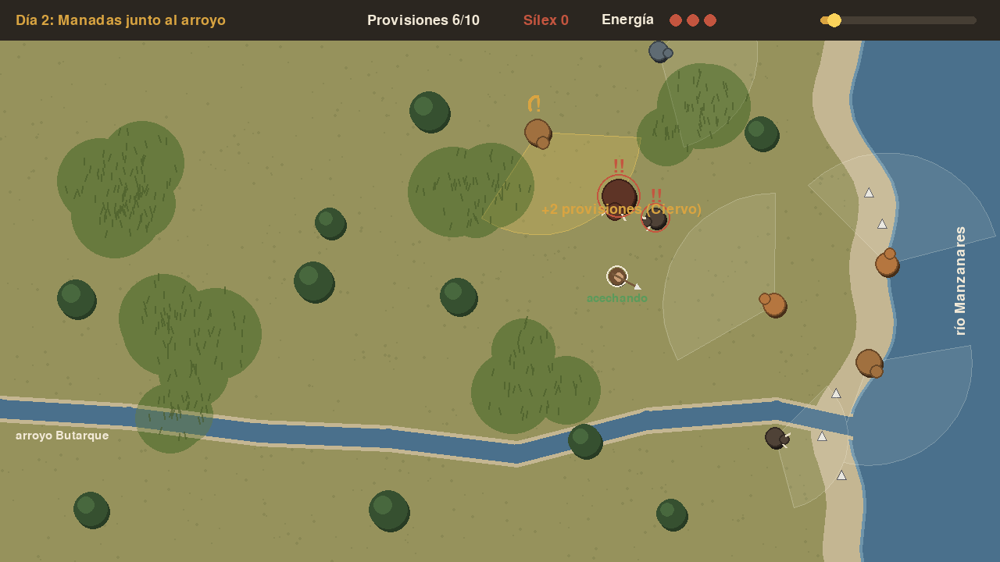

# Cazadores del Manzanares

Tercer minijuego del reto **Arcade de Butarque** (2.º SMR · Digitalización + Programación en Python).

Hace unos 150.000 años, grupos neandertales usaban la llanura de inundación de Butarque, donde el arroyo desemboca en el Manzanares, como zona de caza y despiece. En el yacimiento del Estanque de Tormentas aparecieron herramientas de sílex junto a huesos con marcas de corte. En este juego el jugador es uno de esos cazadores.



## Cómo se juega

No es un juego de disparos: es un juego de **acecho**.

- Cada animal tiene un **cono de visión** (se ve con TAB o V). Si te ve, se pone en alerta y se va llenando un círculo sobre su cabeza. Cuando se llena, reacciona.
- **Correr** hacia un animal que te ve lo asusta enseguida. **Acechar** (SHIFT) lo asusta menos. **Quedarse quieto** cuando te mira casi no lo asusta. Si entras en la **hierba alta**, te ven desde mucho más cerca.
- Caballos, ciervos y asnos **huyen**. Uros, bisontes, jabalíes y el rinoceronte **embisten**: primero rascan el suelo con un "!!" rojo y luego cargan en línea recta, así que hay que apartarse de lado. El **lobo** te persigue en cuanto te ve: corre más que tú cuando acechas, pero menos que tú cuando corres.
- Para cazar hace falta **sílex**: las lascas blancas que hay en la grava de la orilla del río. Cada caza gasta una.
- Hay que reunir las provisiones del día antes de que el sol llegue al final de la barra. Son 3 días, cada vez más difíciles.

**Controles:** flechas o WASD para moverse · SHIFT acechar · ESPACIO cazar · TAB o V conos de visión · ENTER continuar · ESC salir (solo en el ordenador).

## Ponerlo en marcha

```bash
python -m venv .venv
source .venv/bin/activate          # en Windows: .venv\Scripts\activate
pip install -r requirements.txt
python main.py
python -m unittest discover tests  # pruebas de la lógica
```

## Estructura

```
cazadores_manzanares/
├── datos/
│   ├── animales.csv     ← cada especie: comportamiento, vista, nervio, velocidades, valor, dato curioso
│   └── niveles.csv      ← cada día: objetivo, tiempo, hierba, árboles, sílex y qué animales salen
├── main.py              ← punto de entrada (ordenador y navegador)
├── pygbag.ini           ← qué carpetas no se suben a la versión web
├── juego/
│   ├── config.py        ← todos los números ajustables del juego en un sitio
│   ├── datos.py         ← carga y valida los CSV
│   ├── mundo.py         ← el escenario: río, arroyo, hierba, árboles (geometría con vectores)
│   ├── entidades.py     ← jugador y animales: detección y MÁQUINA DE ESTADOS
│   ├── partida.py       ← las reglas de un nivel: caza, sílex, golpes, reapariciones
│   └── principal.py     ← dibujo, teclado y pantallas (lo único que usa la ventana de pygame)
└── tests/test_cazadores.py
```

## La máquina de estados de los animales

```
               te detecta                        se llena la alerta
   PASTA ────────────────────▶ ALERTA ───────────────────────────────▶ HUYE      (caballo, ciervo, asno)
     ▲                           │                                └──▶ AMENAZA ─▶ EMBISTE  (uro, bisonte...)
     │        te pierde          │
     └───────────────────────────┘
   PASTA ──── te detecta ────▶ PERSIGUE   (lobo)
```

Es el concepto central del juego y se puede trabajar en clase antes de mirar el código: dibujar los estados en la pizarra, decidir qué condición lleva de uno a otro y después buscar cada flecha en `Animal.actualizar()`.

## Conceptos de programación que trabaja

| Concepto | Dónde |
|---|---|
| Movimiento con `dt` (independiente de los FPS) | `Jugador.actualizar`, `Animal._avanzar` |
| Vectores: distancia, normalizar, ángulos, rotar | `detectar()`, `_avanzar()` |
| Colisiones círculo-círculo y punto-segmento | `mundo.py` |
| Máquina de estados | `Animal.actualizar()` |
| Separar reglas y dibujo | `partida.py` frente a `principal.py` |
| Datos externos (CSV) y validación | `datos.py` |
| Pruebas automáticas, incluida una simulación larga | `tests/` |

## Cómo se ha ajustado la dificultad

Los valores de `config.py` se han ajustado con jugadores automáticos que juegan cientos de partidas sin ventana:

| Estrategia | Día 1 | Día 2 | Día 3 |
|---|---|---|---|
| Ir siempre corriendo a por la presa | 0 % | ~27 % | ~13 % |
| Acechar, quedarse quieto si te miran, esquivar embestidas y huir del lobo | ~97 % | ~67 % | ~33 % |

La primera versión tenía un fallo de diseño: ir corriendo ganaba **más rápido** que acechar, porque los animales tardaban lo mismo en asustarse hicieras lo que hicieras. Se corrigió haciendo que el miedo dependa de cómo te acercas (`ritmo_de_miedo()`). También se añadió el aviso de AMENAZA antes de embestir, porque las embestidas por sorpresa eran imposibles de esquivar. Es un buen caso real para enseñar que un juego se prueba, se mide y se corrige.

## Contenido a revisar

La fauna y el contexto neandertal salen del documento del yacimiento. Los datos curiosos de cada animal son generales y conviene que los revise alguien del ámbito paleontológico antes de enseñar el juego en público. La caza se representa de forma abstracta: el animal desaparece y suma provisiones, sin mostrar nada explícito.

## Ideas para que los alumnos lo amplíen

- **Manadas:** que los animales de la misma especie se muevan juntos y, si uno huye, huyan todos.
- **Viento:** una dirección de viento que hace que te huelan si estás a barlovento.
- **Trabajo en grupo:** varios cazadores neandertales controlados por el ordenador que acorralan a la presa.
- **Herramientas:** tallar el sílex en la orilla para obtener lascas mejores, con más alcance de caza.
- **Sonido y música** con `pygame.mixer`.
- **Mando o botones físicos** para la maquinita de la Raspberry Pi: el juego ya solo usa flechas, SHIFT y ESPACIO.
