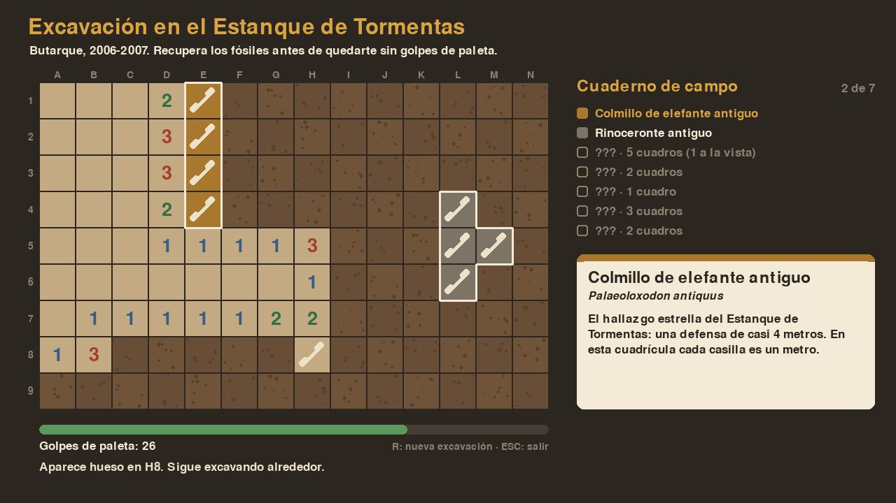

# Excavación en el Estanque de Tormentas

Segundo minijuego del reto **Arcade de Butarque** (2.º SMR · Digitalización + Programación en Python).

Entre 2006 y 2007, durante las obras del Estanque de Tormentas de Butarque, se excavaron dos niveles con fauna del Pleistoceno: un colmillo de elefante antiguo de casi 4 metros, uros, bisontes, caballos y herramientas de sílex neandertales. En este juego el jugador dirige esa excavación.



## Cómo se juega

- La cuadrícula es como la de una excavación real: columnas A–N, filas 1–9, y cada cuadro mide un metro.
- **Clic** en un cuadro: lo excavas y gastas 1 golpe de paleta.
  - Si sale **tierra**, el número indica cuántos cuadros de alrededor esconden hueso. Si es 0, la zona se despeja sola.
  - Si sale **hueso**, toca seguir excavando alrededor hasta destapar el fósil entero.
- Cada fósil completo se apunta en el **cuaderno de campo** con su ficha. Con un clic en el cuaderno se vuelve a ver la ficha.
- Ganas si recuperas todos los fósiles antes de quedarte sin golpes. Si pierdes, se enseña dónde estaban los restos.
- **R**: nueva excavación · **ESC**: salir (solo en el ordenador).

En cada partida aparece siempre el colmillo y se sortean otros 6 fósiles. Cada uno se entierra en un sitio al azar y con un giro al azar.

## Ponerlo en marcha

```bash
python -m venv .venv
source .venv/bin/activate          # en Windows: .venv\Scripts\activate
pip install -r requirements.txt
python main.py
python -m unittest discover tests  # pruebas de la lógica
```

## Estructura

```
excavacion_butarque/
├── datos/fosiles.csv        ← el catálogo de fósiles (contenido editable)
├── main.py                  ← punto de entrada (ordenador y navegador)
├── pygbag.ini               ← qué carpetas no se suben a la versión web
├── juego/
│   ├── datos.py             ← lee y valida el CSV
│   ├── excavacion.py        ← LÓGICA del juego: matriz, giros, pistas, excavado en cadena
│   └── principal.py         ← DIBUJO e interacción con pygame
└── tests/test_excavacion.py ← pruebas automáticas de la lógica
```

**Idea clave:** `excavacion.py` no sabe nada de pygame. La lógica se puede leer, probar y cambiar sin abrir una ventana, y `principal.py` solo se encarga de pintar lo que hay en la matriz y de traducir los clics a "excavar la fila f, columna c".

## Conceptos de programación que trabaja

| Concepto | Dónde aparece |
|---|---|
| Matrices (listas de listas) | `self.ocupante`, `self.excavada` |
| Conjuntos | las casillas de cada fósil (`celdas`, `encontradas`) |
| Recorrer vecinos | `vecinas()` y `pista()` |
| Transformaciones de coordenadas | `girar()` gira una forma 90° |
| Colocación aleatoria con reintentos | `_enterrar()` |
| Recorrido en anchura (cola) | `_excavar_en_cadena()` con `deque` |
| Separación lógica / vista | `excavacion.py` frente a `principal.py` |
| Pruebas automáticas | `tests/` con `unittest` |

## Formato de `fosiles.csv`

| columna | ejemplo | notas |
|---|---|---|
| `forma` | `X.X/XXX` | filas separadas por `/`, `X` = hueso, `.` = hueco |
| `color` | `#8a4b3a` | color del fósil cuando se completa |
| `siempre` | `1` / `0` | `1` = aparece en todas las partidas |

Añadir un fósil nuevo es añadir una fila al CSV, sin tocar el código. Hay un test que comprueba que el catálogo completo cabe en la cuadrícula en 200 partidas distintas.

## Dificultad

Los golpes disponibles son las casillas con hueso más 15 de margen (`GOLPES_EXTRA` en `juego/principal.py`). Simulando 400 partidas, quien excava al azar gana un 34 % de las veces y quien razona con las pistas, un 72 %. Para niveles más fáciles o difíciles basta con cambiar ese número.

## Ideas para que los alumnos lo amplíen

- **Niveles de dificultad:** cuadrícula más grande, más fósiles o menos margen de golpes.
- **Herramientas:** un detector o una brocha que revele una zona de 3×3 a cambio de varios golpes.
- **Estratos:** dos capas, con fauna fría abajo y templada arriba.
- **Fotos en las fichas**, igual que en *Ordena la historia*.
- **Récords** guardados en un fichero.
- **Pista "pendiente":** que el número descuente los huesos que ya se han destapado (es un cambio de una línea en `pista()`, ¿qué cambia en la estrategia?).
