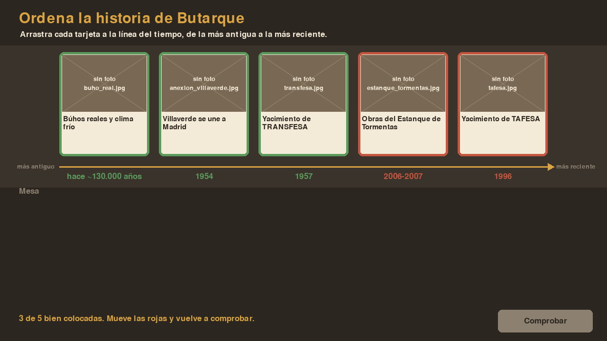

# Ordena la historia de Butarque

Prueba de concepto del minijuego del reto **Arcade de Butarque** (2.º SMR · Digitalización + Programación en Python).

Es la versión digital del puzle de madera de la línea del tiempo de la Mesa Comunitaria *Habitar Butarque*. En cada ronda aparecen 5 hitos al azar y hay que arrastrarlos a la línea del tiempo, del más antiguo al más reciente.



## Ponerlo en marcha

```bash
python -m venv .venv
source .venv/bin/activate          # en Windows: .venv\Scripts\activate
pip install -r requirements.txt
python main.py
```

Controles: arrastrar con el ratón · **ENTER** comprobar · **R** otra ronda · **ESC** salir (solo en el ordenador).
Al pasar el ratón por una tarjeta se ve su descripción abajo.

## Estructura

```
ordena_la_historia/
├── datos/
│   ├── hitos.csv            ← los hitos (lo único que hay que tocar para cambiar el contenido)
│   └── fotos/               ← las fotos del Drive, con el nombre que indica la columna "foto"
├── herramientas/
│   └── excel_a_csv.py       ← convierte el Excel de la Mesa Comunitaria a hitos.csv
├── main.py                  ← punto de entrada (ordenador y navegador)
├── pygbag.ini               ← qué carpetas no se suben a la versión web
├── juego/
│   ├── datos.py             ← carga y valida los hitos (CSV o XLSX)
│   └── principal.py         ← el juego (pygame)
└── requirements.txt
```

La idea clave del proyecto es que **los datos están separados del código**. La Mesa Comunitaria puede corregir o añadir hitos y fotos sin saber programar.

## Formato de `hitos.csv`

| columna | para qué sirve | ejemplo |
|---|---|---|
| `id` | identificador único | `4` |
| `anio` | número para **ordenar** (negativo = "hace X años") | `1957`, `-186000` |
| `fecha_texto` | lo que se enseña al comprobar | `2006-2007` |
| `titulo` | texto de la tarjeta (corto) | `Yacimiento de TRANSFESA` |
| `descripcion` | aparece al pasar el ratón | … |
| `foto` | archivo dentro de `datos/fotos/` (puede ir vacío) | `transfesa.jpg` |

Si falta una foto, el juego dibuja un sustituto con el nombre del archivo que falta. Así se ve enseguida qué fotos quedan por conseguir.

## ⚠️ Datos provisionales

Los 6 hitos actuales son **de ejemplo**. Se han sacado de la descripción del yacimiento (fechas de TRANSFESA, TAFESA y el Estanque de Tormentas) y de la anexión de Villaverde a Madrid (1954). Las fechas de los dos hitos prehistóricos son aproximadas y solo sirven para probar el juego.

El contenido real sale del Excel `LineadeltiempoButarque_completa.xlsx`. Para cargarlo:

1. Abrir el Excel y anotar cómo se llaman sus columnas.
2. Rellenar `CORRESPONDENCIA` en `herramientas/excel_a_csv.py`.
3. Ejecutar `python herramientas/excel_a_csv.py LineadeltiempoButarque_completa.xlsx`.
4. Revisar a mano el CSV: completar `anio` donde la fecha sea un texto, recortar títulos largos y nombrar las fotos.

## Ideas para que los alumnos lo amplíen

- **Niveles:** rondas de 3, 5 y 7 tarjetas, o rondas solo de prehistoria o solo del barrio actual.
- **Puntuación:** contar el tiempo, penalizar los intentos y guardar un ranking en un fichero.
- **Pistas:** un botón que revela la fecha de una tarjeta a cambio de puntos.
- **Sonido:** acierto y error (`pygame.mixer`).
- **Modo exposición:** pantalla completa y vuelta a la portada tras un rato sin tocar, para la maquinita de la Raspberry Pi.
- **Versión web:** empaquetar con `pygbag` para incrustarlo en la web del proyecto de DAW.
- **Validador de datos:** ampliar `datos.py` para avisar de ids repetidos, fotos que no existen o títulos demasiado largos.
